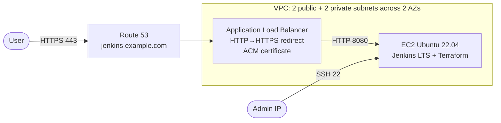

# Terraform Jenkins on AWS

Provisions a Jenkins CI server on AWS with Terraform, served over HTTPS on a custom domain behind an Application Load Balancer.

## Architecture



| Module | What it creates |
|---|---|
| `networking` | VPC, public and private subnets across two AZs, internet gateway, route tables |
| `security-groups` | ALB security group (80/443 public) and Jenkins security group (8080 from the ALB only, SSH from allowed IPs only) |
| `jenkins` | EC2 instance (IMDSv2 enforced, encrypted gp3 root volume) with a cloud-init script that installs Jenkins LTS and Terraform |
| `load-balancer-target-group` | Target group with a `/login` health check |
| `load-balancer` | Application Load Balancer with an HTTP→HTTPS redirect and a TLS 1.3 HTTPS listener |
| `certificate-manager` | ACM certificate with DNS validation |
| `hosted-zone` | Route 53 alias record pointing the domain at the ALB |

## Security choices

- Jenkins is not reachable directly from the internet: port 8080 accepts traffic **only from the load balancer's security group**.
- SSH is restricted to `allowed_ssh_cidrs`; a validation rule rejects `0.0.0.0/0`.
- All HTTP traffic is redirected to HTTPS, with a modern TLS policy.
- IMDSv2 is required on the instance, and the root volume is encrypted.
- No credentials, keys or account-specific values are committed. They live in git-ignored `terraform.tfvars` and `backend.hcl` files.

## Prerequisites

- Terraform ≥ 1.6 and AWS credentials (for example `AWS_PROFILE`).
- A public Route 53 hosted zone for a domain you own.
- An S3 bucket for remote state.

## Usage

```bash
cp backend.hcl.example backend.hcl            # set your state bucket
cp terraform.tfvars.example terraform.tfvars  # set domain, SSH key, your IP

terraform init -backend-config=backend.hcl
terraform plan
terraform apply
```

After the apply finishes, open the `jenkins_url` output. Get the initial admin password with:

```bash
ssh -i <your-private-key> ubuntu@<jenkins_public_ip> \
  'sudo cat /var/lib/jenkins/secrets/initialAdminPassword'
```

Run `terraform destroy` to tear everything down. The ALB and EC2 instance incur hourly costs.

## CI

GitHub Actions (`.github/workflows/terraform-ci.yml`) runs on every push and pull request:
`terraform fmt -check`, `terraform validate`, `tflint`, and a Checkov security scan.

## Possible next steps

- Move Jenkins into the private subnets behind a NAT gateway and use SSM Session Manager instead of SSH.
- Store Jenkins data on a separate EBS volume with snapshot backups.
- Add Jenkins agents as an Auto Scaling group.

## Credits

The initial structure was based on a public Terraform + Jenkins tutorial by Rahul Wagh ([jhooq.org](https://jhooq.org)). It was then refactored and extended with tighter security groups, an HTTPS redirect, certificate validation, dynamic AMI lookup, parameterized configuration and CI.
